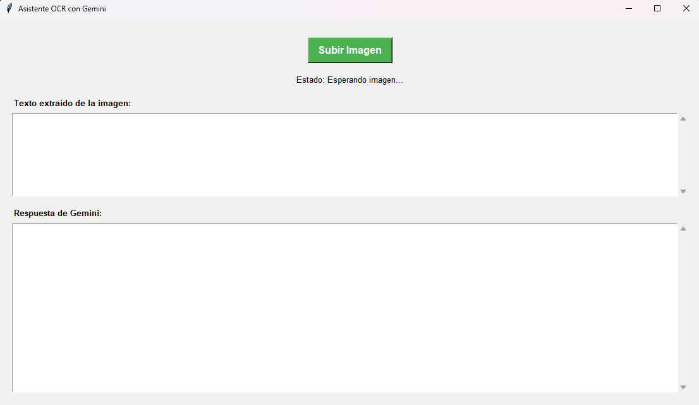

# Convert Image To Text



# Extractor de Texto de Imágenes (OCR) 📝

Una aplicación de escritorio ligera construida con Python y Tkinter que permite extraer texto de imágenes (PNG, JPG, BMP) manteniendo el orden y la estructura original de los párrafos.

## Requisitos previos
1. Descargar e instalar [Tesseract OCR para Windows](https://github.com/UB-Mannheim/tesseract/wiki).
2. Durante la instalación de Tesseract, asegúrate de marcar la descarga del idioma **Spanish (español)**.

## Instalación de librerías
Abre tu terminal y ejecuta:
```bash
pip install pytesseract pillow
